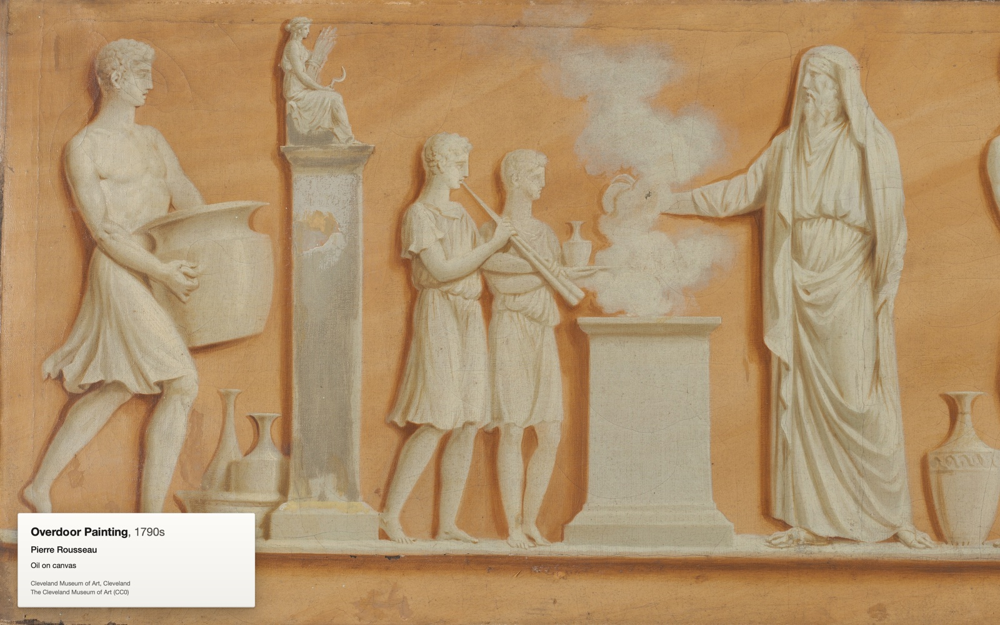
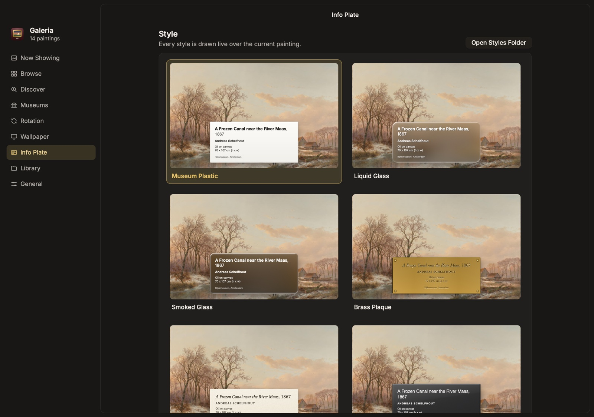
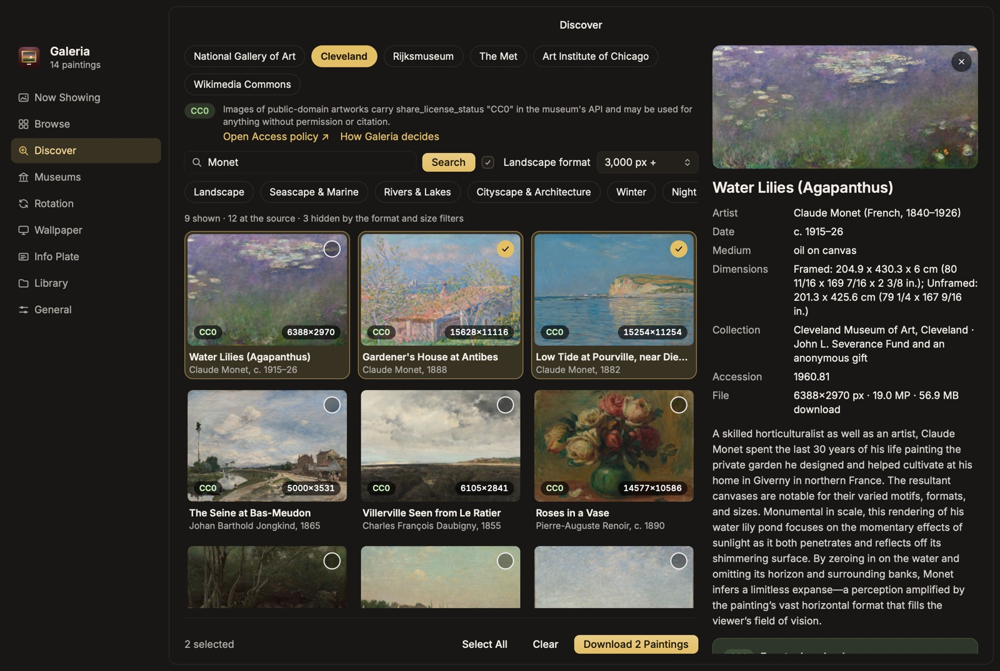

# Galeria

*Galeria* is Medieval Latin for a gallery. (The classical word for a picture gallery is *pinacotheca*.)

Galeria turns a folder of high-resolution painting scans into a museum on your desktop:

- **Live desktop.** The painting is drawn in a window that sits behind your desktop icons, the same technique [Plash](https://github.com/sindresorhus/Plash) uses. It can also set the real system wallpaper, so Mission Control, Spaces and the lock screen match.
- **Fitted to every display.** Galeria compares each painting's aspect ratio with the display's. Works close to the screen's shape fill it edge to edge. Unusually wide or tall works slowly pan from one edge to the other so you see the whole canvas over time, or they hang on a gallery wall (tinted to the painting, blurred, or a colour of your choice) with an optional gilded, walnut, black or white frame.
- **Museum info plate.** Title, artist, nationality and life dates, date, medium, dimensions, description, collection and credit line, accession number, image credit, license, and an optional QR code to the museum page. You can hide the plate, snap it to a corner, or drag it anywhere on the desktop.
- **Plate styles.** Museum Plastic, Liquid Glass, Smoked Glass, Brass Plaque, Paper Card, Black Acrylic and Minimal are built in. The glass, brass, acrylic and paper surfaces and the gilded and lacquered frames are drawn by GPU shaders. You can add your own styles as small JSON files, and they reload when you save.
- **Full-screen viewer.** A distraction-free mode where the mouse reveals the painting: move left/right (or up/down) to travel edge to edge, scroll or pinch to zoom up to past 1:1, and use the minimap to see where you are.
- **Menu bar app.** Every option lives in the menu bar: painting, rotation, fit, panning, wall, frame and plate. There's no Dock icon unless you turn it on.
- **Nothing bundled.** Galeria stores only the location of your art folder. It reads `manifest.json` from that folder, checks that every file it lists exists and is a readable image, and watches the folder for changes. The paintings are never copied or shipped with the app.
- **Optional museum lookup.** Galeria can fill in missing descriptions, artist details, credit lines and English titles from the Cleveland Museum of Art and Rijksmuseum open APIs, Wikidata and Wikipedia. Results are cached locally, not written to the manifest.
- **Discover and download, legally.** Browse thumbnails from the National Gallery of Art, the Cleveland Museum of Art, the Rijksmuseum, The Met, the Art Institute of Chicago and Wikimedia Commons, pick the paintings you like and download them into your art folder. Every download is checked against licensing rules compiled into the app. See [Downloading paintings](#downloading-paintings).
- **Show everything, or a group.** Rotate through the whole library, your favorites, a playlist, chosen museums and genres, or a hand-picked selection. Museums can be switched off without deleting anything.
- **Light and dark.** Galeria measures how bright each painting is and can show brighter paintings in Light Mode and darker ones in Dark Mode.






The pictures above are the app's own windows rendered offscreen with `galeria ui --snap` (see [Command line](#command-line)).

## Building

Requirements: Rust. The pinned toolchain in `rust-toolchain.toml` installs itself via rustup. There is no Node, web view or bundler step.

```sh
cargo run                        # run in development
cargo test                       # the tests (the live museum API tests are ignored by default)
packaging/macos/bundle.sh        # release build → target/bundle/Galeria.app (macOS)
packaging/macos/dmg.sh           # the disk image to hand out → target/bundle/Galeria-<version>.dmg
cargo build --release            # a bare binary on Windows and Linux
```

`packaging/macos/bundle.sh` assembles and signs the bundle (ad hoc, or with `GALERIA_SIGN="Developer ID Application: …"`). It does not install or start it. `packaging/macos/dmg.sh` wraps it in a disk image (it needs python3, and installs `dmgbuild` into `target/dmg-venv` the first time). Release builds can be signed with Developer ID and notarized when Apple credentials are configured; Windows installers and Linux packages are also published. On Linux the build needs the OpenSSL development headers.

Galeria checks GitHub Releases for updates and can install them from Settings. See [updates](docs/updates.md) for release signing, packaging and local testing.

The first launch walks you through it: what Galeria does, where to keep the paintings (it suggests `~/Pictures/Galeria` and starts an empty `manifest.json` there), and a first set to download from a museum. You can also set the folder up front with `GALERIA_LIBRARY=/path/to/folder`.

## Using it

### Menu bar

The menu bar item has everything: next/previous painting, *Open in Viewer*, the museum page / Wikipedia / file for the current painting, *Never Show Again*, the rotation interval and order, fit mode, panning (on/off, pause, speed), the wall and frame, the info plate (show/hide, style, position, size, which details appear, *Drag on Desktop…*), library status and issues, and options for the system wallpaper, Dock icon, launch at login and online lookups.

### Moving the plate

Choose **Info Plate → Position → Drag on Desktop…**. This lifts the wallpaper above the desktop icons, though still below every app window. Drag the plate anywhere; it snaps to edges and centre lines. Press **Done** or **Esc** when you're finished. Each display remembers its own position.

### Viewer

| Key | Action |
| --- | --- |
| move the mouse | reveal the painting edge to edge |
| scroll / pinch | zoom |
| double-click, `F` | whole painting ↔ fill the screen |
| `0` | reset zoom |
| `←` `→` | previous / next painting |
| `I` | show or hide the plate (drag it anywhere) |
| `W` | use as desktop wallpaper |
| `O` | open the museum page |
| `?` | help |
| `Esc` | close |

### Command line

When Galeria is already running, launching it again with a flag controls the running app. This makes it easy to bind hotkeys with Raycast, Alfred, skhd, Hammerspoon or similar:

```sh
/Applications/Galeria.app/Contents/MacOS/galeria --next
```

| Flag | |
| --- | --- |
| `--next`, `--prev` | change the painting on every display |
| `--show <id>` | show one painting now, by its manifest id (e.g. `nga:100922`) |
| `--viewer`, `--close-viewer` | open / close the full-screen viewer |
| `--settings [section]` | open settings (`now`, `browse`, `discover`, `sources`, `rotation`, `wallpaper`, `plate`, `library`, `general`) |
| `--toggle-plate`, `--toggle-panning` | |
| `--arrange`, `--done` | enter / leave plate-arranging mode |
| `--menu <id>` | trigger any menu item, e.g. `--menu style:glass`, `--menu fit:pan`, `--menu speed:10`, `--menu interval:60`, `--menu scope:favorites`, `--menu scope-genre:seascape`, `--menu match-appearance` |
| `--theme light\|dark\|auto` | pretend the system is in that appearance (to try light/dark matching) |
| `--check-update`, `--install-update` | check for an update, or install the one on offer and restart |
| `--debug` | the core logs what is showing and why |
| `--quit` | quit the running app |

Set `GALERIA_HOME=/some/folder` to keep settings, state and caches in a folder of your choosing instead of the system locations. It is handy for trying things against a copy of your library. A run with `GALERIA_HOME` set never changes what launches at login.

`galeria ui` renders the windows offscreen, without opening any, for screenshots and debugging:

```sh
galeria ui --list-windows                                   # settings, wall, viewer
galeria ui --window wall --list-scenes                      # gilded, pan, brass, arrange, …
galeria ui --window wall --scene gilded --snap out.png --size 1600x1000
galeria ui --window settings --scene plate --theme light --snap plate.png
```

`GALERIA_UI_PAINTING=<id>` picks the painting. Without `GALERIA_HOME` it works on a private copy of your settings and never writes to the real ones. `galeria ui --help` lists the rest (frame dumps, video, scripted input).

## Choosing what is shown

**Rotation → What to Show** (or **Show** in the menu bar) decides which paintings take part:

| Choice | Paintings |
| --- | --- |
| Everything | the whole library |
| Favorites | paintings you starred |
| A playlist | a named set. Create playlists in Rotation; fill them in Browse with **Select → Add to playlist** |
| Chosen museums and genres | any mix, e.g. seascapes from the Rijksmuseum |
| My selection | a one-off set: in Browse, **Select**, tick paintings, **Show Only These** |

Two things always apply on top. Paintings you marked *Never Show* stay hidden, and so do museums switched off in the **Museums** tab (nothing is deleted; switch them back on any time). If a choice leaves nothing to show, Galeria shows everything rather than a blank desktop, and says so.

**Genres** come from the manifest's `tags`, `kind` and `category`, plus keywords in the title. The list (Landscape, Seascape & Marine, Rivers & Lakes, Cityscape & Architecture, Winter, Night & Sunset, Gardens & Flowers, Still Life, Figures & Everyday Life, Portrait, Religious, Orthodox & Icons, Mythology & History, Animals, East Asian) lives in [`resources/genres.json`](resources/genres.json).

### Light and dark

Turn on **Rotation → Light & Dark → Match the system appearance** and Galeria shows brighter paintings in Light Mode and darker ones in Dark Mode. When the appearance switches, a painting that no longer fits is replaced straight away (optional).

Brightness is the mean luma (Rec. 601, 0–255) of the painting. Galeria uses the manifest's `brightness` when it is there and measures the rest itself in the background. The dividing line is automatic by default: the median of your library, so each mode gets about half of it. You can set your own line instead, and override any single painting to Light, Dark or Both in Browse.

## Downloading paintings

The **Discover** tab searches a museum, shows thumbnails with the image size and license, and downloads what you select into your art folder. Downloads are saved as JPEG next to your other paintings (larger originals are scaled to a long edge you choose, 8,000 px by default), measured for brightness, and added to `manifest.json`, so they join the rotation at once.

### The licensing rules

Galeria downloads an image only when its rights holder has put it in the public domain or under a license that lets anyone use it freely: **CC0, Public Domain Mark, CC BY or CC BY-SA**. NonCommercial and NoDerivatives licenses, "in copyright" statements, and anything it does not recognise are refused.

The rules are data, in [`resources/licensing.json`](resources/licensing.json), compiled into the app and shown in the **Museums** tab. For each source they name the field of the museum's own record that proves a work is open:

| Source | Programme | Proof Galeria checks on every record |
| --- | --- | --- |
| National Gallery of Art | Open Access, CC0 | `openaccess = 1` in the Gallery's open dataset |
| Cleveland Museum of Art | Open Access, CC0 | `share_license_status = CC0` |
| Rijksmuseum | public domain / CC0 | the record's rights statement is Public Domain Mark or CC0, and the image is marked downloadable |
| The Metropolitan Museum of Art | Open Access, CC0 | `isPublicDomain = true` |
| Art Institute of Chicago | Open Access, CC0 | `is_public_domain = true` |
| Wikimedia Commons | per file | the file's own license, matched against the accepted list |

A download never trusts the search result it was picked from. The record is read again from the museum, the rule is evaluated again, and only then is the image fetched. The license, its URL, the evidence (for example `share_license_status = CC0`) and the date of the check are written into the manifest entry.

Museums without an open-access programme (the Louvre, the Musée d'Orsay, the Prado, the Uffizi, the Kunsthistorisches Museum, the Tretyakov Gallery and others) are listed in the same file with what their terms say. Galeria never downloads from them. Their works are offered only as Wikimedia Commons files whose own license passes. Photographs under CC BY or CC BY-SA require credit, so for those the plate always shows the photographer and license, even when the credit line is switched off.

The rules were reviewed on the date in the file. Museums say they release only works they believe to be in the public domain and give no warranty about third-party rights; neither does Galeria. This is not legal advice.

### What Galeria changes in your folder

Galeria writes to the art folder only when you download something, when you ask it to remove manifest entries whose files are gone, or to start an empty `manifest.json` in a folder that has none (it never replaces one). It adds the image file and appends one entry to `manifest.json`. Existing entries, key order and indentation are left exactly as they were. The file is re-read just before writing and replaced atomically, and a copy of the previous manifest is kept in the app data folder (`manifest-backups/`, the last eight). If another tool later rewrites the manifest without Galeria's entries, Galeria lists its downloads again as long as the files are still there.

The National Gallery of Art has no search API. The first time you open it in Discover, Galeria downloads the Gallery's open dataset once, keeps a small index of the open-access paintings in the cache folder and searches that locally.

## The art folder

The folder holds `manifest.json` next to the images. Galeria creates an empty one during the first run, or from **Library → Create manifest.json** for a folder that has none; you can also write your own. The manifest can be a bare array, `{ "items": [...] }`, `{ "paintings": [...] }` or `{ "artworks": [...] }`. Only `file` is required; it must be a path relative to the folder, and subfolders are fine.

```jsonc
{
  "items": [
    {
      "file": "van-gogh__wheat-field-with-cypresses.jpg",
      "id": "met:436535",                     // optional stable id (defaults to `file`)
      "title": "Wheat Field with Cypresses",
      "artist": "Vincent van Gogh",
      "artist_bio": "Dutch, 1853–1890",
      "date": "1889",
      "medium": "oil on canvas",
      "dimensions": "73 × 93.4 cm",
      "description": "Painted in Saint-Rémy…",
      "museum": "The Metropolitan Museum of Art",
      "credit_line": "Purchase, The Annenberg Foundation Gift, 1993",
      "accession": "1993.132",
      "credit": "Image: The Met (CC0)",
      "license": "CC0",
      "source": "met",                        // nga | cma | rijks | met | … (used for online lookups)
      "source_id": "436535",
      "source_page": "https://www.metmuseum.org/art/collection/search/436535",
      "tags": ["landscape"],
      "width": 4000, "height": 3184           // optional; read from the file when missing
    }
  ]
}
```

Common aliases work too (`path`, `name`, `painter`, `year`, `period`, `creditLine`, `url`, …). Any other scalar fields are kept and passed to the plate. Optional `brightness` (0–255), `kind`, `category` and `attribution_required` are used for light/dark matching, genres and the credit line.

Validation runs on every change. The Library tab and the menu show which entries point to missing files, which are invalid (not an image, path escapes the folder, missing `file`), which are duplicates, and which images in the folder aren't in the manifest. Paintings whose files are missing are skipped, as are files modified in the last 20 seconds, so a half-downloaded image never becomes your wallpaper.

## Custom plate styles

**Info Plate → New Custom Style** creates a documented JSON file in the styles folder and opens it. On macOS that folder is `~/Library/Application Support/com.nikolovlazar.galeria/plate-styles/`. Saving the file updates every display immediately. The file name is the style id. A style names a built-in to start from and lists what it changes; lines starting with `//` are comments:

```jsonc
// neon-night.json
{
  "name": "Neon Night",
  "base": "minimal",
  "ink": "#e8fbff",
  "background": "#080a18c7",
  "radius": 0.8,
  "border": { "width": 1, "color": "#3ef2ff" },
  "glow": { "blur": 1.4, "color": "#3ef2ff8c" },
  "title": { "color": "#ff5ec8", "weight": 700 },
  "artist": { "color": "#3ef2ff", "uppercase": true, "tracking": 0.12 }
}
```

The plate: `base`, `ink`, `font`, `background` (a colour, a list of colours for a gradient with `angle`, or `"none"`), `frost`, `radius`, `padding`, `border`, `shadow`, `glow`, `textShadow`, `align`, and `material` (`gilt`, `brass`, `acrylic`, `glass`, `smoked`, `paper`: a shader-drawn surface). Each line of the label (`title`, `date`, `originalTitle`, `artist`, `bio`, `meta`, `description`, `footer`) takes `color`, `size`, `weight`, `italic`, `uppercase`, `tracking`, `opacity` and `lineHeight`. Sizes are in em, so the size setting scales your style. A file that is not valid JSON is listed in Settings with what is wrong. See [`examples/plate-styles/`](examples/plate-styles/).

Styles written as CSS for earlier versions are not read; they have to be rewritten in this format.

## Online lookups

When enabled (the default), a background worker goes through the library about once a second:

| Source | What it adds |
| --- | --- |
| Cleveland Museum of Art open-access API | description, "did you know", artist nationality & dates, credit line, accession number, technique, measurements |
| Rijksmuseum Linked Art | English title, description (often only in Dutch; hidden unless *Descriptions in other languages* is on), dimensions, object number |
| Wikidata (via the museum's own object ID) | artist nationality and life dates, the Wikipedia article |
| Wikipedia | a description when the museum has none (credited as CC BY-SA on the plate) |

The cache lives in `enrichment.json` in the app data folder. Values from your manifest always take precedence.

## Platform notes

| | Live desktop | System wallpaper | Status |
| --- | --- | --- | --- |
| **macOS** | NSWindow at `kCGDesktopWindowLevel`, on all Spaces | `NSWorkspace.setDesktopImageURL` (per display, fit/fill + fill colour) | runs; the only platform tried so far |
| **Windows** | window parented to the desktop `WorkerW` (behind the icons) | `IDesktopWallpaper` (per monitor) | type-checks; never run |
| **Linux / X11** | `_NET_WM_WINDOW_TYPE_DESKTOP`, kept below and sticky | GNOME, Cinnamon, MATE, KDE, XFCE, sway, Hyprland (`swww`/`hyprpaper`), or `feh` | type-checks; never run |
| **Linux / Wayland** | not possible without layer-shell, so live mode turns off | as above | |

On macOS, `NSWorkspace` only changes the wallpaper of the current Space. The live desktop window shows on every Space regardless.

The menu bar item uses the system's own menus on macOS and Windows. On Linux it is a flat menu without submenus.

## Where things are stored

- Settings: `settings.json` in the app config dir (`~/Library/Application Support/com.nikolovlazar.galeria/` on macOS)
- Runtime state (what's showing, history, your original wallpaper): `state.json`
- Online lookup cache: `enrichment.json`
- Brightness Galeria measured itself: `tones.json`
- What Galeria downloaded: `downloads.json`; copies of the manifest from before each change: `manifest-backups/`
- The National Gallery of Art index: `catalogs/` in the app cache dir
- Thumbnails and display-sized renditions: the app cache dir. Clear them from *Library → Cache*.

## How it's built

Rust throughout. The windows are drawn on the GPU by [Rune](https://github.com/anomalyco/rune), a native UI framework (no web view); the frames and plate materials are shaders written with `rune-fx`. Rune is pinned to a git revision in `Cargo.toml`.

```
src/
  core.rs       state, rotation, assignments, system-wallpaper sync, enrichment worker
  host.rs       the seam between the core and the windows (the `Shell` trait), the async runtime
  library.rs    manifest parsing + validation
  images.rs     display-sized renditions and thumbnails (cached), colour management
  enrich.rs     museum APIs / Wikidata / Wikipedia
  licensing.rs  the download rules (resources/licensing.json) and the license decision
  sources/      one provider per museum: search, license evidence, image address
  download.rs   the download queue: re-check the license, fetch, verify, save, record
  manifest.rs   appends to manifest.json without disturbing it
  genres.rs     genre list (resources/genres.json) and classification
  tone.rs       brightness measurement and light/dark
  styles.rs     custom plate styles (JSON files)
  menu.rs       the menu bar item's contents, independent of any toolkit
  actions.rs    what the windows and the menu can ask the core to do
  instance.rs   one running instance; later launches forward their flags to it
  cli.rs        command-line control
  platform/     macOS, Windows, Linux desktop-window + wallpaper glue
  shell/        the Rune app: windows, menu bar item, `galeria ui`
  ui/
    installer.rs  the picture behind the installer window (packaging/macos/dmg.sh)
    stage.rs      layout math and the pan
    plate.rs      plate styles, the label, placement and snapping
    fx.rs         shader materials: gilt, lacquer, brass, acrylic, glass, paper grain
    wallpaper.rs  the desktop window
    viewer.rs     the full-screen viewer
    settings/     the settings window, one file per page, and the first run (onboarding.rs)
```

The slow pan moves the painting one device pixel at a time and sleeps in between (at most 30 updates a second, none while resting at an edge or paused), so an idle desktop draws nothing. The pan's phase is tied to when the painting appeared, so restarting the app doesn't send it back to the edge.

Set `GALERIA_FX=0` to draw the frames and plates with plain gradients instead of shaders.

## License

MIT for the code. The paintings are yours to choose: Galeria never includes any. Images you download keep the license their museum or author gave them, which Galeria records in your manifest.
