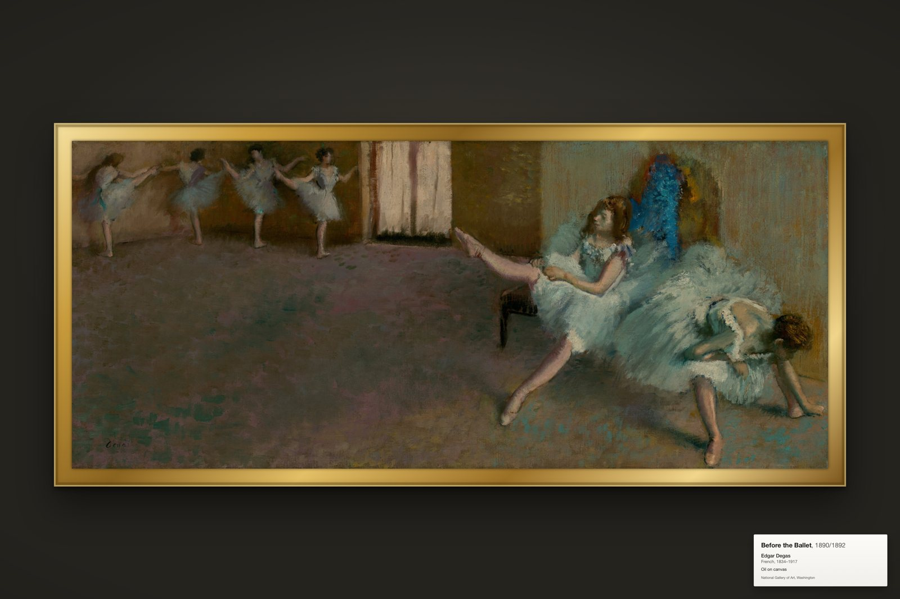

# Galeria

*Galeria* is Medieval Latin for a gallery. (The classical word for a picture gallery is *pinacotheca*.)

Galeria turns a folder of high-resolution painting scans into a museum on your desktop:

- **Live desktop.** The painting is drawn in a window that sits behind your desktop icons, the same technique [Plash](https://github.com/sindresorhus/Plash) uses. It can also set the real system wallpaper, so Mission Control, Spaces and the lock screen match.
- **Fitted to every display.** Galeria compares each painting's aspect ratio with the display's. Works close to the screen's shape fill it edge to edge. Unusually wide or tall works slowly pan from one edge to the other so you see the whole canvas over time, or they hang on a gallery wall (tinted to the painting, blurred, or a colour of your choice) with an optional gilded, walnut, black or white frame.
- **Museum info plate.** Title, artist, nationality and life dates, date, medium, dimensions, description, collection and credit line, accession number, image credit, license, and an optional QR code to the museum page. You can hide the plate, snap it to a corner, or drag it anywhere on the desktop.
- **Plate styles.** Museum Plastic, Liquid Glass, Smoked Glass, Brass Plaque, Paper Card, Black Acrylic and Minimal are built in. You can add your own as plain CSS files, and they hot-reload.
- **Full-screen viewer.** A distraction-free mode where the mouse reveals the painting: move left/right (or up/down) to travel edge to edge, scroll or pinch to zoom up to past 1:1, and use the minimap to see where you are.
- **Menu bar app.** Every option lives in the menu bar: painting, rotation, fit, panning, wall, frame and plate. There's no Dock icon unless you turn it on.
- **Nothing bundled.** Galeria stores only the location of your art folder. It reads `manifest.json` from that folder, checks that every file it lists exists and is a readable image, and watches the folder for changes. The paintings are never copied or shipped with the app.
- **Optional museum lookup.** Galeria can fill in missing descriptions, artist details, credit lines and English titles from the Cleveland Museum of Art and Rijksmuseum open APIs, Wikidata and Wikipedia. Results are cached locally and the manifest is never modified.




## Building

Requirements: Rust (the pinned toolchain in `rust-toolchain.toml` installs itself via rustup), Node 20+, and the [Tauri prerequisites](https://v2.tauri.app/start/prerequisites/) for your OS.

```sh
npm install
npm run tauri dev        # run in development
npm run app              # build Galeria.app (macOS) → src-tauri/target/release/bundle/macos/
npm run tauri build      # installers for the current platform (.dmg / .msi / .deb / .AppImage …)
```

Run the Rust tests with `cd src-tauri && cargo test`.

On first launch Galeria asks for your art folder. You can also set it up front with `GALERIA_LIBRARY=/path/to/folder`.

## Using it

### Menu bar

The menu bar item has everything: next/previous painting, *Open in Viewer*, the museum page / Wikipedia / file for the current painting, *Never Show Again*, the rotation interval and order, fit mode, panning (on/off, pause, speed), the wall and frame, the info plate (show/hide, style, position, size, which details appear, *Drag on Desktop…*), library status and issues, and options for the system wallpaper, Dock icon, launch at login and online lookups.

### Moving the plate

Choose **Info Plate → Position → Drag on Desktop…**. This lifts the wallpaper above the desktop icons, though still below every app window. Drag the plate anywhere; it snaps to edges and centre lines. Press **Done** or **Esc** when you're finished. Each display remembers its own position.

### Viewer

| Key | Action |
| --- | --- |
| move the mouse | reveal the painting edge to edge |
| scroll / pinch | zoom |
| double-click, `F` | whole painting ↔ fill the screen |
| `0` | reset zoom |
| `←` `→` | previous / next painting |
| `I` | show or hide the plate (drag it anywhere) |
| `W` | use as desktop wallpaper |
| `O` | open the museum page |
| `?` | help |
| `Esc` | close |

### Command line

When Galeria is already running, launching it again with a flag controls the running app. This makes it easy to bind hotkeys with Raycast, Alfred, skhd, Hammerspoon or similar:

```sh
/Applications/Galeria.app/Contents/MacOS/galeria --next
```

| Flag | |
| --- | --- |
| `--next`, `--prev` | change the painting on every display |
| `--viewer` | open the full-screen viewer |
| `--settings [section]` | open settings (`now`, `browse`, `wallpaper`, `plate`, `rotation`, `library`, `general`) |
| `--toggle-plate`, `--toggle-panning` | |
| `--arrange`, `--done` | enter / leave plate-arranging mode |
| `--menu <id>` | trigger any menu item, e.g. `--menu style:glass`, `--menu fit:pan`, `--menu speed:10`, `--menu interval:60` |
| `--capture <dir>` | write PNG snapshots of every Galeria window (macOS, debugging) |
| `--debug` | every window logs its render state |

## The art folder

The folder must contain `manifest.json` next to the images. The manifest can be a bare array, `{ "items": [...] }`, `{ "paintings": [...] }` or `{ "artworks": [...] }`. Only `file` is required; it must be a path relative to the folder, and subfolders are fine.

```jsonc
{
  "items": [
    {
      "file": "van-gogh__wheat-field-with-cypresses.jpg",
      "id": "met:436535",                     // optional stable id (defaults to `file`)
      "title": "Wheat Field with Cypresses",
      "artist": "Vincent van Gogh",
      "artist_bio": "Dutch, 1853–1890",
      "date": "1889",
      "medium": "oil on canvas",
      "dimensions": "73 × 93.4 cm",
      "description": "Painted in Saint-Rémy…",
      "museum": "The Metropolitan Museum of Art",
      "credit_line": "Purchase, The Annenberg Foundation Gift, 1993",
      "accession": "1993.132",
      "credit": "Image: The Met (CC0)",
      "license": "CC0",
      "source": "met",                        // nga | cma | rijks | met | … (used for online lookups)
      "source_id": "436535",
      "source_page": "https://www.metmuseum.org/art/collection/search/436535",
      "tags": ["landscape"],
      "width": 4000, "height": 3184           // optional; read from the file when missing
    }
  ]
}
```

Common aliases work too (`path`, `name`, `painter`, `year`, `period`, `creditLine`, `url`, …). Any other scalar fields are kept and passed to the plate.

Validation runs on every change. The Library tab and the menu show which entries point to missing files, which are invalid (not an image, path escapes the folder, missing `file`), which are duplicates, and which images in the folder aren't in the manifest. Paintings whose files are missing are skipped, as are files modified in the last 20 seconds, so a half-downloaded image never becomes your wallpaper.

## Custom plate styles

**Info Plate → New Custom Style** creates a documented CSS file in the styles folder and opens it. On macOS that folder is `~/Library/Application Support/com.nikolovlazar.galeria/plate-styles/`. Saving the file updates every display immediately. The file name is the style id:

```css
/* name: Neon Night */
.plate[data-style="neon-night"] { background: rgba(8, 10, 24, .78); color: #e8fbff; border-radius: .8em; }
.plate[data-style="neon-night"] .plate-title { color: #ff5ec8; }
```

Available elements: `.plate-body`, `.plate-heading` (`.plate-title`, `.plate-date`), `.plate-original-title`, `.plate-artist`, `.plate-bio`, `.plate-meta` (`.plate-medium`, `.plate-dimensions`), `.plate-description`, `.plate-footer` (`.plate-museum`, `.plate-credit-line`, `.plate-accession`, `.plate-credit`, `.plate-license`, `.plate-text-credit`) and `.plate-qr`. Use `em` units so the size setting scales your style. See [`examples/plate-styles/`](examples/plate-styles/).

## Online lookups

When enabled (the default), a background worker goes through the library about once a second:

| Source | What it adds |
| --- | --- |
| Cleveland Museum of Art open-access API | description, "did you know", artist nationality & dates, credit line, accession number, technique, measurements |
| Rijksmuseum Linked Art | English title, description (often only in Dutch; hidden unless *Descriptions in other languages* is on), dimensions, object number |
| Wikidata (via the museum's own object ID) | artist nationality and life dates, the Wikipedia article |
| Wikipedia | a description when the museum has none (credited as CC BY-SA on the plate) |

The cache lives in `enrichment.json` in the app data folder. Values from your manifest always take precedence.

## Platform notes

| | Live desktop | System wallpaper | Status |
| --- | --- | --- | --- |
| **macOS** | NSWindow at `kCGDesktopWindowLevel`, on all Spaces | `NSWorkspace.setDesktopImageURL` (per display, fit/fill + fill colour) | daily driver |
| **Windows** | WebView parented to the desktop `WorkerW` (behind the icons) | `IDesktopWallpaper` (per monitor) | compiles; not yet tested on hardware |
| **Linux / X11** | `_NET_WM_WINDOW_TYPE_DESKTOP`, kept below and sticky | GNOME, Cinnamon, MATE, KDE, XFCE, sway, Hyprland (`swww`/`hyprpaper`), or `feh` | compiles; not yet tested on hardware |
| **Linux / Wayland** | not possible without layer-shell, so live mode turns off | as above | |

On macOS, `NSWorkspace` only changes the wallpaper of the current Space. The live desktop window shows on every Space regardless.

## Where things are stored

- Settings: `settings.json` in the app config dir (`~/Library/Application Support/com.nikolovlazar.galeria/` on macOS)
- Runtime state (what's showing, history, your original wallpaper): `state.json`
- Online lookup cache: `enrichment.json`
- Thumbnails and display-sized renditions: the app cache dir. Clear them from *Library → Cache*.

## How it's built

[Tauri 2](https://v2.tauri.app). The backend is Rust and the windows are system webviews (WebKit on macOS and Linux, WebView2 on Windows).

```
src-tauri/src/
  core.rs       state, rotation, assignments, system-wallpaper sync, enrichment worker
  library.rs    manifest parsing + validation
  images.rs     galeria:// protocol: originals, display-sized renditions, thumbnails (cached)
  enrich.rs     museum APIs / Wikidata / Wikipedia
  wall.rs       wallpaper, viewer and settings windows
  tray.rs       menu bar item
  platform/     macOS, Windows, Linux desktop-window + wallpaper glue
  cli.rs        command-line control
src/
  shared/       layout math, plate renderer, plate styles, stage (crossfades + pan animation)
  wallpaper/    the desktop window
  viewer/       the full-screen viewer
  settings/     the settings window (React)
```

The slow pan moves the painting one device pixel at a time and sleeps in between (at most 30 updates a second, none while resting at an edge or paused). An infinite CSS animation looks the same but keeps WebKit busy every frame. The pan's phase is tied to when the painting appeared, so restarting the app doesn't send it back to the edge.

## License

MIT for the code. The paintings are yours to choose: Galeria never includes any.
